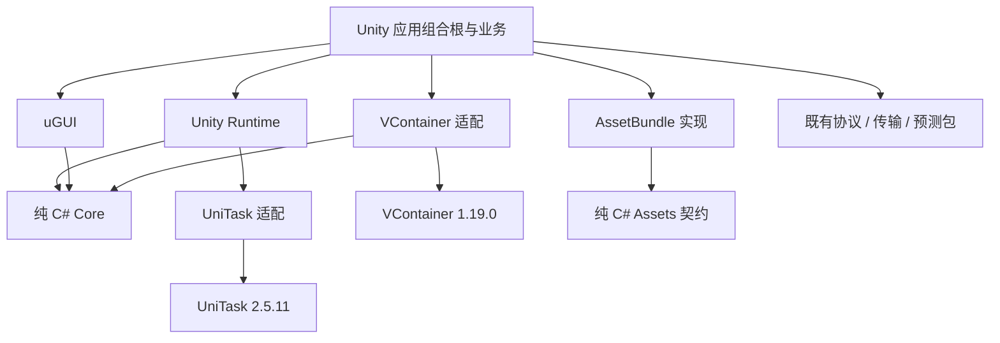

# Module Dependency Matrix

Status: Frozen for the first vertical slice
Authority: ADR-0002
Last updated: 2026-10-01

This document defines compile-time and runtime dependency direction. “May depend” still requires an explicit manifest reference and a concrete need; it is not a default reference.

## Six-layer matrix

Rows are consumers and columns are dependencies.

| Consumer \\ Dependency | Client | Server | Shared | Tools | Infrastructure | Agents |
| --- | --- | --- | --- | --- | --- | --- |
| **Client** | Within package rules | Forbidden | Allowed | Forbidden at runtime | Forbidden | Forbidden |
| **Server** | Forbidden | Within module rules | Allowed | Forbidden at runtime | Forbidden | Forbidden |
| **Shared** | Forbidden | Forbidden | Within acyclic submodules | Forbidden | Forbidden | Forbidden |
| **Tools** | Inspect/generate only | Inspect/generate only | Allowed for test/codegen models | Within tool rules | Forbidden as product dependency | May read context |
| **Infrastructure** | Compose artifacts only | Compose artifacts only | No source dependency | May invoke pinned tools | Within deployment code | May read runbooks |
| **Agents** | Read/change via workflow | Read/change via workflow | Read/change via workflow | Invoke documented tools | Read/change via workflow | Within scoped rules |

“Inspect/generate” and “compose” are build/development relationships, not runtime assembly references. Agents are engineering participants, not a product process or library.

## Canonical ownership

| Root | Owns | Must not own |
| --- | --- | --- |
| `client/UnityProject` | Application composition, scenes, product integration | Reusable framework package implementation |
| `packages` | UPM runtime/editor/test packages and client adapters | Server modules or product-specific scene content |
| `server/src/Hosts` | Deployable composition roots and configuration binding | Gameplay rules or module internals |
| `server/src/Modules` | Server abstractions, adapters, backend/battle modules | Unity types or another module's persistence internals |
| `shared/schemas` | Wire schemas, IDs, compatibility declarations | Transport/session implementations |
| `shared/generated` | Reproducible generated artifacts | Handwritten gameplay rules |
| `shared/gameplay` | Unity-independent simulation values, rules, ports | Engine/framework/I/O concerns |
| `shared/test-vectors` | Cross-runtime fixtures and golden vectors | Environment-specific expected output |
| `tools` | CLI, codegen, architecture/build/test tooling | Shipped runtime behavior |
| `infrastructure` | CI, images, deployment, observability configuration | Gameplay/domain rules |
| `agents` | Agent context, rules, skills, workflows | Runtime code or secrets |
| `samples` | Minimal composition examples and vertical slices | Canonical framework implementation |

## Intra-layer rules

### Client

- Each plugin is a UPM package with Runtime, optional Editor, Tests, and Samples boundaries.
- Runtime asmdefs never reference Editor asmdefs. Editor may reference its package Runtime assembly.
- Core abstractions reference Shared; optional implementations reference Core abstractions and their third-party SDK.
- The Unity application Composition Root references selected implementation packages. Core never references them back.
- An optional package missing from `Packages/manifest.json` and package manifests contributes no assembly reference.
- Per ADR-0019, `com.ainative.client.protocol` owns client codec contracts and depends only on Shared Gameplay/Realtime. Prediction depends on those contracts, never the Protobuf implementation. `com.ainative.client.protocol.protobuf` owns generated-message mapping and depends inward on the contract. The application selects and injects the implementation. Gate depends on the Protobuf facade; generated types do not escape its business API. Tests may reference implementation assemblies explicitly.
- `com.ainative.client.fantasy` is the only Client package allowed to reference `Fantasy` namespaces. Its Runtime assembly depends on `AiNative.Realtime` and pinned `Fantasy.Unity`; Fantasy Session, generated registration, KCP, and socket types terminate there. The prediction package and Unity application Composition Root consume only project-owned contracts and application state.

### 客户端基础框架（ADR-0021）

[ADR-0021](../ADR/0021-client-framework-foundation.md) 冻结以下方向；箭头表示运行时程序集引用。

| 包 | 允许的直接依赖 | 所有权与限制 |
| --- | --- | --- |
| `com.ainative.client.core` | BCL | 无 Unity 引用；生命周期、MVVM 和诊断端口 |
| `com.ainative.client.async.unitask` | UniTask 2.5.11、Unity | 将 Unity 等待转换为 `ValueTask`；第三方任务类型止于适配实现 |
| `com.ainative.client.composition.vcontainer` | Core、VContainer 1.19.0 | 仅装配层注册/解析；容器类型不进入业务或 Shared 端口 |
| `com.ainative.client.runtime` | Core、UniTask 适配包、Unity | 内容场景串行切换和 Unity 诊断 |
| `com.ainative.client.assets` | BCL | 项目自有资源 ID、句柄及服务契约 |
| `com.ainative.client.assets.assetbundle` | Assets、Unity | 随包目录、Bundle 加载和实例所有权；Editor 构建引用本包 Runtime |
| `com.ainative.client.ui.ugui` | Core、uGUI、Input System、Unity | 强类型绑定、列表与页面层级；业务 ViewModel 留在应用 |
| `client/UnityProject` | 上述选用包及既有协议、传输、预测包 | 配置快照、登录/对局流程和场景组合；唯一驱动网络/预测时序 |

图中省略 BCL、Unity/uGUI/Input System 基础程序集；箭头表示允许的依赖方向，
不是要求每个业务对象都引用所有实现包。Editor 与 Tests 的额外引用不进入 Runtime。

Assets 与 Core 均不引入 Unity 或第三方任务/容器类型。应用拥有子作用域，按“界面/流程停止 → 子容器释放 → 应用资源释放”收尾；容器 Dispose 不替代异步停止。
此表是依赖约束，不代表 Windows/macOS Player、Android IL2CPP 或移动真机已验收。
实际方法与所有权见 [公共契约](public-api-contracts.md#客户端基础框架adr-0021)。

### Server

- Hosts reference module public contracts/registration packages, never module internals. Per ADR-0017, Gate, Player, Lobby, Match, Room Coordinator and Battle are independent composition roots; no Host may reference another Host (ARC009). These six Hosts may reference the pinned `Fantasy-Net` package only for compile-time generated startup metadata; handwritten Fantasy runtime namespace usage remains inside `AiNative.Server.Fantasy`.
- A module owns configuration, persistence schema/migrations, and public contracts. Modules do not share tables or implementation types.
- Cross-module calls use public contracts/events. Cycles are forbidden; orchestration belongs in a Host/application module.
- Fantasy, ASP.NET Core, EF Core, native physics/navigation, and telemetry SDK types terminate at adapters/composition roots.
- Battle Tick code does not call slow persistence, blocking I/O, exporter, or navigation-build paths.

### Shared

- Recommended direction: `Contracts/Primitives -> Gameplay Model -> Gameplay Rules`; test support depends inward only.
- Shared must not reference `UnityEngine`, Fantasy, ASP.NET Core, EF Core, databases, sockets, filesystem APIs, native P/Invoke, UI/rendering, platform SDKs, wall-clock time, or uncontrolled scheduling.
- Per ADR-0013, `shared/realtime` may use `CancellationToken`, `ValueTask`, and `IAsyncDisposable` as passive boundary types; active scheduling and I/O remain forbidden, and `shared/gameplay` receives no exception.
- Public ports are owned by the consumer policy layer (Shared); adapters are owned by Client/Server.
- Generated wire types do not become the gameplay domain model by default. Translation occurs at a boundary.

## Plugin contract

Every plugin declares:

1. Stable package/module ID and owner.
2. Public abstractions/contracts and their compatibility policy.
3. Explicit manifest dependencies.
4. Registration entry point called by a Composition Root—never discovered by runtime scanning.
5. Lifecycle and disposal behavior, threading constraints, configuration schema, diagnostics, and tests.
6. Whether it is AOT/IL2CPP safe and which platforms/runtimes it supports.

## Automated enforcement

CI derives the graph from `package.json`, `.asmdef`, `.csproj`, solution/build manifests, and schema generator configuration. It fails on forbidden edges, cross-module cycles, Editor-to-Runtime edges, direct Shared forbidden APIs, Fantasy namespace use outside `AiNative.Server.Fantasy` and `com.ainative.client.fantasy`, disallowed Fantasy package references, runtime references to Tools/Infrastructure/Agents, or undocumented new public contracts.

Unity-generated `.csproj` and `.sln` files directly under `client/UnityProject` are excluded from the manifest graph. Nested projects, Assets sources and asmdefs remain checked; genuine repository projects must appear in a repository solution.

See [ADR-0002](../ADR/0002-repository-layout-and-module-dependencies.md) for migration and rollback rules.
